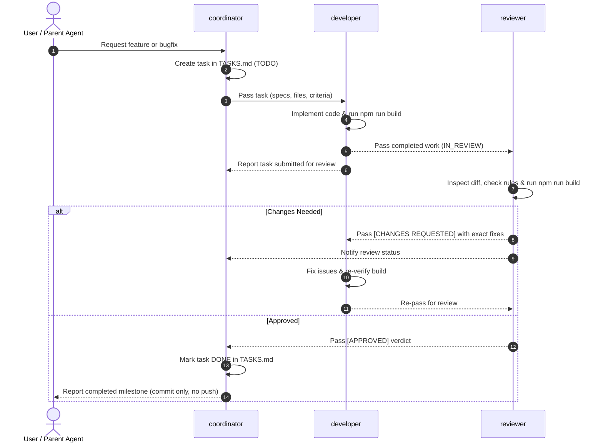

# Team Agents Directory (`digital-seafood`)

This directory defines the 3 collaborative AI agents configured for `/Users/vanthiev/Documents/website/collaborate_ai`, including full inter-agent handoff (**pass**) permissions.

---

## Agents & Permissions Matrix

| Agent | File | Role | Write & Build Tools | Subagent Pass Tools | Pass Authority |
| :--- | :--- | :--- | :---: | :---: | :--- |
| **`coordinator`** | [coordinator.md](file:///Users/vanthiev/Documents/website/collaborate_ai/agents/coordinator.md) | Task Planner & Orchestrator | `true` | `true` | Creates tasks in `TASKS.md`, assigns/passes to `developer`, dispatches to `reviewer`, finalizes `DONE` |
| **`developer`** | [developer.md](file:///Users/vanthiev/Documents/website/collaborate_ai/agents/developer.md) | Software Engineer | `true` | `true` | Implements assigned tasks, runs `npm run build`, passes completed tasks to `reviewer` & `coordinator` |
| **`reviewer`** | [reviewer.md](file:///Users/vanthiev/Documents/website/collaborate_ai/agents/reviewer.md) | QA & Code Reviewer | `true` | `true` | Audits code & build, grants `[APPROVED]` pass to `coordinator` or routes `[CHANGES REQUESTED]` back to `developer` |

---

## Pass & Handoff Workflow

---

## Related Project Files
- [AGENTS.md](file:///Users/vanthiev/Documents/website/collaborate_ai/AGENTS.md) — Global project rules & commit-only Git policy
- [TASKS.md](file:///Users/vanthiev/Documents/website/collaborate_ai/TASKS.md) — Shared task board for Coordinator, Developer, and Reviewer
- [DEVELOPMENT_LOG.md](file:///Users/vanthiev/Documents/website/collaborate_ai/DEVELOPMENT_LOG.md) — Architecture map and chronological dev log
